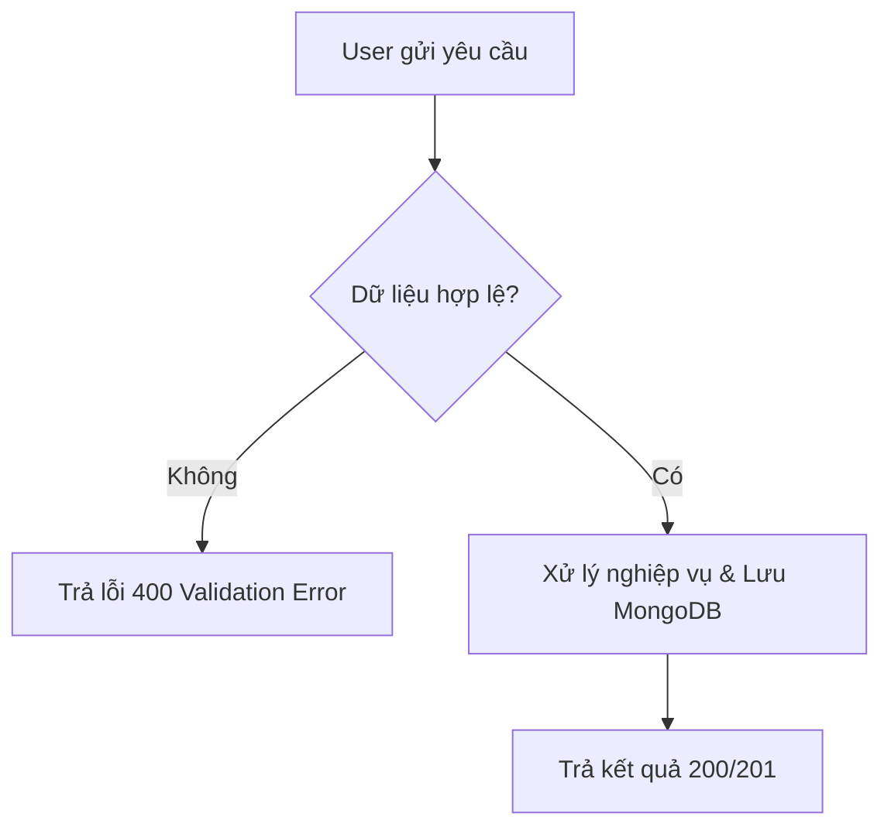

# Mẫu Tài Liệu Đặc Tả Yêu Cầu Phần Mềm (SRS Template)

```markdown
# [Tên Tính Năng / Dự Án] — Software Requirements Specification (SRS)
- **Phiên bản:** 1.0
- **Người lập:** `ba-analyst`
- **Trạng thái:** Draft | Pending Approval | Approved

## 1. Mục tiêu & Phạm vi (Objectives & Scope)
- **Mục tiêu kinh doanh:** ...
- **Trong phạm vi (In-Scope):** ...
- **Ngoài phạm vi (Out-of-Scope):** ...

## 2. Tác nhân & Ma trận Phân quyền (Actors & RBAC Matrix)
| Chức năng / Hành động | Guest | User | Manager | Admin | Ghi chú điều kiện |
| :--- | :---: | :---: | :---: | :---: | :--- |
| Xem danh sách | ✅ | ✅ | ✅ | ✅ | Chỉ hiển thị bản ghi `status = active` |
| Tạo mới | ❌ | ✅ | ✅ | ✅ | Yêu cầu đã xác thực email |

## 3. Sơ đồ Luồng Nghiệp vụ (Business Process & State Diagrams)


## 4. Quy tắc Nghiệp vụ (Business Rules)
| Mã BR | Tên quy tắc | Mô tả chi tiết |
| :--- | :--- | :--- |
| `BR-01` | ... | ... |
| `BR-02` | ... | ... |

## 5. Đặc tả Chức năng & Dữ liệu (Functional Requirements & Data Fields)
### FR-01: [Tên chức năng]
- **Mô tả:** ...
- **Dữ liệu đầu vào (Inputs & Validation):**
  | Trường (Field) | Kiểu (Type) | Bắt buộc | Quy tắc kiểm tra (Validation Rule) | Thông báo lỗi (Error Message) |
  | :--- | :--- | :---: | :--- | :--- |
  | `email` | String | Có | Chuẩn RFC 5322, lowercase, unique | "Email không hợp lệ hoặc đã tồn tại" |
- **Xử lý hệ thống (Processing Logic):** ...
- **Đầu ra (Outputs & Side Effects):** ...

## 6. Tiêu chí Nghiệm thu (Acceptance Criteria - Gherkin)
### Kịch bản 1: Thành công chuẩn (Happy Path)
- **Given:** ...
- **When:** ...
- **Then:** ...

### Kịch bản 2: Dữ liệu biên / Lỗi (Edge & Negative Cases)
- **Given:** ...
- **When:** ...
- **Then:** ...
```
