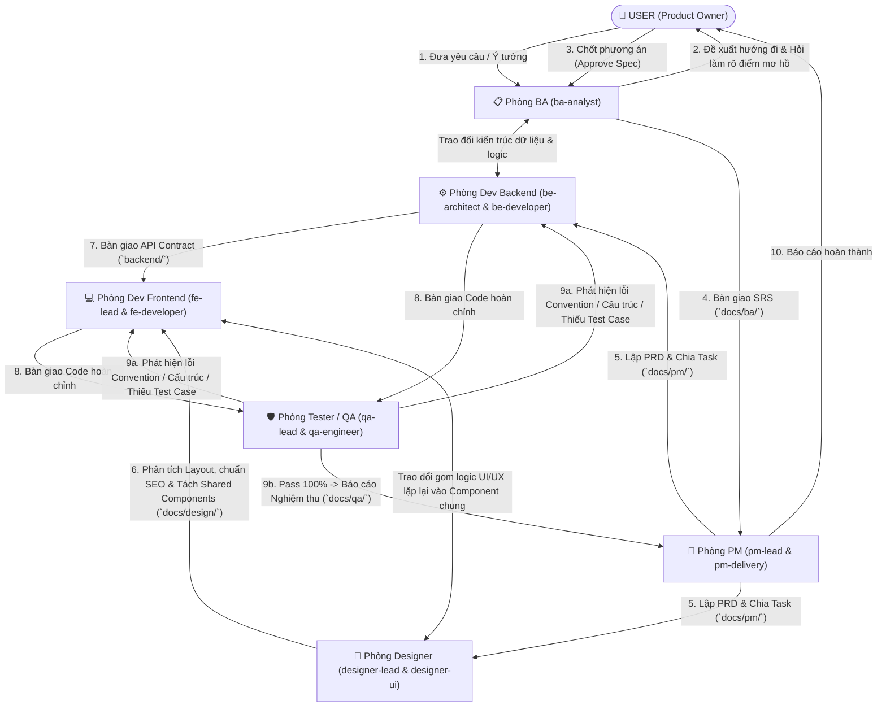

# Quy Chế Vận Hành Công Ty Công Nghệ DTU-Startup (AI Multi-Agent Organization)

## 1. NGUYÊN TẮC TỐI THƯỢNG: PHÂN CÔNG ĐÚNG BỘ PHẬN — KHÔNG TỰ Ý LÀM THAY
1. **Main Agent (Orchestrator / Tổng Điều Phối)** đóng vai trò là Ban Giám Đốc Điều Hành:
   - **TUYỆT ĐỐI KHÔNG tự ý viết code, tự thiết kế giao diện hay tự suy diễn yêu cầu nghiệp vụ.**
   - Mọi công việc chuyên môn **BẮT BUỘC** phải được giao đúng về từng phòng ban thông qua công cụ `invoke_subagent` và `send_message` (nếu subagent chưa được định nghĩa trong phiên chat mới, hãy đọc `.agents/agents/<name>.md` và gọi `define_subagent` để khởi tạo ngay).
2. **Công nghệ cốt lõi của dự án (Tech Stack)**:
   - **Frontend (`frontend/`)**: ReactJS, NextJS (App Router, SSR/ISR, chuẩn SEO & Core Web Vitals).
   - **Backend (`backend/`)**: NodeJS + Express + MongoDB (Mongoose ODM).
3. **Bộ Skills bắt buộc toàn công ty**:
   - **Graphify Knowledge Graph**: `.agents/skills/graphify/SKILL.md`
   - **Vercel React Best Practices**: `.agents/skills/vercel-react-best-practices/SKILL.md`

---

## 2. SƠ ĐỒ TỔ CHỨC 6 PHÒNG BAN (11 SUBAGENTS)

| Phòng ban | Số lượng | Mã Subagent (`TypeName`) | Chức danh & Chuyên môn | Bộ Skills bắt buộc |
| :--- | :---: | :--- | :--- | :--- |
| **1. Product Management (PM)** | 2 | `pm-lead` `pm-delivery` | - `pm-lead`: Chiến lược sản phẩm, PRD, Roadmap, ưu tiên tính năng. - `pm-delivery`: Bóc tách Epic/User Story/Task, phân việc và theo dõi bàn giao liên phòng ban. | `.agents/skills/product-manager-skills/SKILL.md` `.agents/skills/graphify/SKILL.md` |
| **2. Business Analysis (BA)** | 1 | `ba-analyst` | - Cầu nối giữa User và toàn team. Phân tích nghiệp vụ, đề xuất phương án (kèm ưu/nhược điểm), hỏi lại User để làm rõ mọi điểm mơ hồ. - Viết SRS, Use Cases, RBAC Matrix và trao đổi với `be-architect`. | `.agents/skills/business-analyst/SKILL.md` `.agents/skills/graphify/SKILL.md` |
| **3. UI/UX Designer** | 2 | `designer-lead` `designer-ui` | - `designer-lead`: Phân tích Layout tổng thể trước khi thiết kế, chuẩn hóa SEO & Semantic HTML, gom các phần tử lặp lại vào **Shared Components**. - `designer-ui`: Thiết kế chi tiết từng màn hình, trạng thái UI/UX (Loading/Empty/Error) & đặc tả Component Props cho FE. | `.agents/skills/frontend-design/SKILL.md` `.agents/skills/frontend-component-governance/SKILL.md` `.agents/skills/vercel-react-best-practices/SKILL.md` |
| **4. Dev Frontend** | 2 | `fe-lead` `fe-developer` | - `fe-lead`: Kiến trúc `frontend/` (NextJS/ReactJS), quản lý `frontend/src/components/REGISTRY.md`, trao đổi ngược với Designer nếu thấy logic UI/UX lặp lại để gom vào Component chung. - `fe-developer`: Ghép trang, tích hợp API, tối ưu render. - **CẤM TẠO THỪA CODE UI: Phải kiểm tra trong `components/` trước khi code.** | `.agents/skills/vercel-react-best-practices/SKILL.md` `.agents/skills/frontend-component-governance/SKILL.md` `.agents/skills/frontend-design/SKILL.md` `.agents/skills/graphify/SKILL.md` |
| **5. Dev Backend** | 2 | `be-architect` `be-developer` | - `be-architect`: Trao đổi với `ba-analyst` để chốt giải pháp hệ thống tốt nhất (Bảo mật, đúng logic, tối ưu Mongoose Schema/Index, đúng cấu trúc `backend/`). - `be-developer`: Xây dựng RESTful APIs, Services, Middlewares, Validation, Error handling. | `.agents/skills/nodejs-express-mongoose-architecture/SKILL.md` `.agents/skills/graphify/SKILL.md` |
| **6. Tester (QA)** | 2 | `qa-lead` `qa-engineer` | - `qa-lead`: Kiểm tra cấu trúc bàn giao của Dev, kiểm tra coding convention, bắt lỗi tạo thừa/trùng lặp Component UI, rà soát bảo mật. - `qa-engineer`: Lập và chạy toàn bộ Test Cases (Happy, Edge, Negative, Security) xem có feature nào chưa đạt yêu cầu không. | `.agents/skills/claude-skills/SKILL.md` `.agents/skills/senior-qa/SKILL.md` `.agents/skills/code-reviewer/SKILL.md` `.agents/skills/tdd-guide/SKILL.md` `.agents/skills/api-test-suite-builder/SKILL.md` |

---

## 3. LUỒNG PHỐI HỢP CHUẨN GIỮA USER VÀ CÁC PHÒNG BAN (WORKFLOW)

### Quy tắc thực thi từng chặng:
1. **Chặng 1 (Khởi tạo & Làm rõ — Bắt buộc qua BA)**:
   - Ngay khi User đưa yêu cầu mới, gọi `ba-analyst` phân tích, đề xuất các hướng đi và đặt câu hỏi làm rõ với User (có thể tham vấn nhanh `be-architect` nếu liên quan sâu đến kỹ thuật DB/Security).
   - **Dừng lại chờ User xác nhận chốt Spec** trước khi triển khai hàng loạt.
2. **Chặng 2 (Sau khi User chốt Spec — Tự động điều phối toàn chuỗi)**:
   - **Bước 2.1 (PM)**: `pm-lead` và `pm-delivery` lập PRD và chia task cụ thể cho Designer, BE, FE, QA tại `docs/pm/`.
   - **Bước 2.2 (Designer & Backend song song)**:
     - `designer-lead` phân tích layout chuẩn SEO, tách Shared Components; `designer-ui` thiết kế chi tiết màn hình tại `docs/design/`.
     - `be-architect` thiết kế Mongoose Schema & Security; `be-developer` code API tại `backend/`.
   - **Bước 2.3 (Frontend)**:
     - `fe-lead` và `fe-developer` **kiểm tra `frontend/src/components/REGISTRY.md` và `frontend/src/components/` trước khi làm**, phản biện với Designer nếu có UI/UX lặp lại để đưa vào Component dùng chung, sau đó code giao diện và ghép API.
   - **Bước 2.4 (Tester / QA)**:
     - `qa-lead` kiểm tra cấu trúc dự án, convention, kiểm tra chống tạo thừa code UI và kiểm tra Zero-Hardcoding (Keys, Màu, Text, Hình ảnh, Icon).
     - `qa-engineer` chạy vét cạn mọi Test Case. Nếu còn bất kỳ lỗi nào hoặc feature chưa đạt, trả lại cho Dev sửa ngay cho đến khi đạt 100%.

---

## 4. QUY TẮC CẤM HARDCODE TUYỆT ĐỐI (ZERO-HARDCODING GOVERNANCE — BẮT BUỘC CHO BE, FE & QA)

Toàn bộ phòng Dev Backend (`be-architect`, `be-developer`), Dev Frontend (`fe-lead`, `fe-developer`) và Tester/QA (`qa-lead`, `qa-engineer`) **BẮT BUỘC** tuân thủ và kiểm toán 5 nguyên tắc chống hardcode sau:
1. **Không Hardcode Keys / Secrets / URLs / Ports**: Phải đặt trong `.env` / `.env.local` và đọc qua `backend/src/config/env.js` hoặc `frontend/src/config/env.ts`.
2. **Không Hardcode Màu Sắc (Colors)**: Phải quản lý qua CSS Variables (`globals.css`), Semantic Classes (`tailwind.config.ts`) và `config/theme.ts` (`config/theme.js`). **CẤM** dùng class mã hex trực tiếp (`bg-[#...]`, `text-[#...]`, `border-[#...]`) trong JSX/TSX.
3. **Không Hardcode Text (Đa Ngôn Ngữ — i18n)**: Mọi chuỗi văn bản hiển thị hoặc thông báo API phải đặt trong từ điển đa ngôn ngữ (`frontend/src/i18n/` hỗ trợ `vi`/`en` qua `useI18n()`, và `backend/src/i18n/messages.js`).
4. **Không Hardcode Hình Ảnh & Media (Asset Registry)**: Mọi URL hình ảnh, placeholder, 3D textures phải quản lý tập trung tại `frontend/src/config/assets.ts` và `backend/src/config/assets.js`.
5. **Không Hardcode Icon (Icon Registry)**: Mọi icon trên giao diện phải quản lý tập trung tại `frontend/src/config/icons.ts` và render qua Shared Component `<AppIcon name="..." />` (`frontend/src/components/ui/AppIcon.tsx`).
