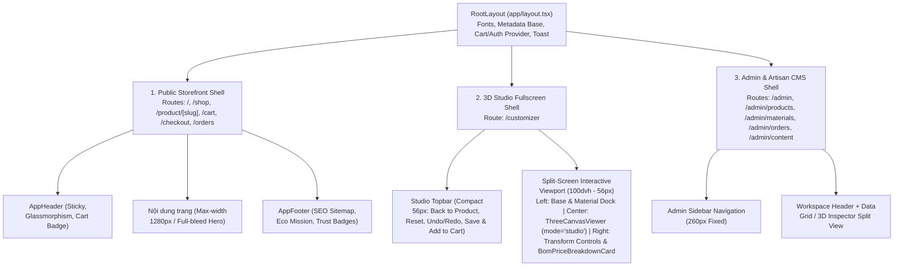

# Kiến Trúc Layout Tổng Thể, Chuẩn Hóa SEO & Quy Hoạch Shared Components (DES-01 & DES-02)
- **Mã tài liệu:** `DES-ARCH-UPCYCLED-3D-V1.0`
- **Người lập:** `designer-lead` (UI/UX System & SEO Layout Architect)
- **Tham chiếu:** [srs-upcycled-ecommerce-3d.md](file:///Users/nguynbao/workspace/DTU-Startup/docs/ba/srs-upcycled-ecommerce-3d.md), [sprint-backlog-and-tasks.md](file:///Users/nguynbao/workspace/DTU-Startup/docs/pm/sprint-backlog-and-tasks.md)
- **Trạng thái:** Approved for `designer-ui` & `fe-lead`

---

## 1. Phân Tích Tổng Thể Kiến Trúc Layout (Global Layout Architecture)

Hệ thống bao gồm **3 phân hệ Web** chạy trên cùng một codebase Next.js App Router (`frontend/src/app/`), sử dụng **3 App Shells** chuyên biệt để tối ưu trải nghiệm người dùng và Core Web Vitals:

### 1.1. Sơ Đồ 3 App Shells (Layout Shells)

---

## 2. Chuẩn Hóa Cấu Trúc SEO, Semantic HTML5 & Core Web Vitals (DES-01)

| Route | Thẻ Semantic HTML5 Bắt Buộc | Nội dung Thẻ `<h1>` Duy Nhất | Chiến lược Render & Metadata (`robots`) | Structured Data (JSON-LD) |
| :--- | :--- | :--- | :--- | :--- |
| `/` (LandingPage) | `<header>`, `<nav>`, `<main>`, 5x `<section>`, `<article>`, `<footer>` | `<h1>`: *Từ Lưới Ma Đại Dương Đến Phụ Kiện Thủ Công Độc Bản* | SSR / ISR (`revalidate: 60`), `index, follow` | `Organization`, `WebSite` |
| `/shop` (Cửa hàng) | `<header>`, `<nav>`, `<main>`, `<section>` (Filter + Grid), `<article>` (mỗi `ProductCard`), `<footer>` | `<h1>`: *Cửa Hàng Sản Phẩm Tái Chế Lưới Đánh Cá & Phụ Kiện Biển* | SSR theo SearchParams, `index, follow` | `CollectionPage`, `ItemList` |
| `/product/[slug]` | `<header>`, `<nav aria-label="Breadcrumb">`, `<main>`, `<article>`, `<section>`, `<footer>` | `<h1>`: *`{product.name}`* | SSR (`generateMetadata` động từ API), `index, follow` | `Product`, `BreadcrumbList` |
| `/customizer` | `<header>`, `<main>`, `<aside>` (Left Dock & Right BOM Panel), `<section>` (3D Viewport) | `<h1>`: *Xưởng Thiết Kế 3D Cá Nhân Hóa* | Client Interactive Canvas wrapped in SSR Metadata Shell | `WebApplication` |
| `/cart` & `/checkout` | `<header>`, `<main>`, `<section>`, `<aside>`, `<footer>` | `/cart`: `<h1>` *Giỏ Hàng Xanh Của Bạn* `/checkout`: `<h1>` *Thanh Toán & Đặt Xưởng Chế Tác* | Client Dynamic, `noindex, nofollow` | Không yêu cầu |
| `/orders` & `/orders/[orderCode]` | `<header>`, `<main>`, `<section>`, `<footer>` | `<h1>`: *Tra Cứu Tiến Độ Chế Tác Đơn Hàng* | SSR / CSR kết hợp, `noindex, nofollow` | Không yêu cầu |
| `/admin/*` (Web CMS) | `<aside>` (Sidebar `<nav>`), `<header>`, `<main>`, `<section>` | `<h1>` theo từng phân mục quản trị | Protected Route (`staff`/`admin`), `noindex, nofollow` | Không yêu cầu |

---

## 3. Quy Hoạch Hệ Thống Shared Components Dùng Chung Giữa 3 Phân Hệ (DES-02)

| STT | Tên Component | Thư mục lưu trữ | Dùng ở Web LandingPage (`/`) | Dùng ở Web Store (`/shop`, `/product`, `/customizer`, `/cart`, `/orders`) | Dùng ở Web CMS (`/admin/*`) |
| :-: | :--- | :--- | :---: | :---: | :---: |
| 1 | `ThreeCanvasViewer` | `src/components/three/ThreeCanvasViewer.tsx` | ✅ (Hero / Studio Teaser) | ✅ (`preview` ở Product Detail & Order Lookup; `studio` ở `/customizer`) | ✅ (`inspector` ở Phiếu chế tác 3D `/admin/orders`) |
| 2 | `BomPriceBreakdownCard` | `src/components/common/BomPriceBreakdownCard.tsx` | ❌ | ✅ (Bảng giá realtime ở `/customizer`, tóm tắt BOM ở `/cart` & `/checkout`) | ✅ (BOM Checklist cho thợ thủ công ở `/admin/orders`) |
| 3 | `EcoImpactBadge` | `src/components/common/EcoImpactBadge.tsx` | ✅ (4 thẻ Impact Counter & Product Card) | ✅ (Badge trên `ProductCard`, bảng chỉ số ở `/product/[slug]`, tổng gram lưới ở `/cart`) | ✅ (Thống kê tổng lưới tái chế ở `/admin` Dashboard & bảng Products) |
| 4 | `OrderStatusStepper` | `src/components/common/OrderStatusStepper.tsx` | ❌ | ✅ (Tiến độ 6 bước ở `/orders` & `/orders/[orderCode]`) | ✅ (Thanh cập nhật trạng thái đơn ở `/admin/orders`) |
| 5 | `ProductCard` | `src/components/common/ProductCard.tsx` | ✅ (Featured Products Grid) | ✅ (Danh sách `/shop`, Sản phẩm liên quan ở `/product/[slug]`) | ❌ |
| 6 | `FilterToolbar` | `src/components/common/FilterToolbar.tsx` | ❌ | ✅ (Thanh tìm kiếm, lọc danh mục, giá, Custom 3D ở `/shop`) | ✅ (Bộ lọc sản phẩm, lọc nguyên liệu vỏ sò/ốc, lọc đơn hàng ở `/admin/*`) |
| 7 | `StatusBadge` | `src/components/ui/StatusBadge.tsx` | ❌ | ✅ (Trạng thái đơn hàng, trạng thái thanh toán VietQR/COD) | ✅ (Trạng thái đơn, cảnh báo tồn kho thấp, trạng thái Active/Hidden) |
| 8 | `ModalConfirm` | `src/components/ui/ModalConfirm.tsx` | ❌ | ✅ (Xác nhận hủy đơn hàng `pending`, xác nhận làm mới phôi 3D) | ✅ (Xác nhận xóa sản phẩm/nguyên liệu, xác nhận chuyển trạng thái đơn) |
| 9 | `EmptyState` | `src/components/common/EmptyState.tsx` | ❌ | ✅ (Không tìm thấy sản phẩm, Giỏ hàng trống, Chưa có phụ kiện gắn) | ✅ (Danh sách đơn/sản phẩm trống khi lọc) |
| 10 | `AppHeader` | `src/components/layout/AppHeader.tsx` | ✅ (Public Header) | ✅ (Public Header + Compact Studio Header mode) | ✅ (Topbar điều hướng nhanh về Storefront) |
| 11 | `AppFooter` | `src/components/layout/AppFooter.tsx` | ✅ (Full SEO Footer) | ✅ (Full SEO Footer trên tất cả trang Store trừ `/customizer`) | ❌ |
| 12 | `SectionHeading` | `src/components/common/SectionHeading.tsx` | ✅ (Tiêu đề mọi `<section>` trên LandingPage) | ✅ (Tiêu đề các khu vực trên `/shop`, `/product/[slug]`, `/orders`) | ✅ (Tiêu đề từng phân khu trong `/admin/*`) |
| 13 | `PriceTag` | `src/components/ui/PriceTag.tsx` | ✅ (Giá trên Featured Products) | ✅ (Hiển thị giá VNĐ đồng nhất ở mọi nơi) | ✅ (Hiển thị doanh thu, đơn giá phôi, đơn giá vỏ sò/ốc) |
| 14 | `DataTable` | `src/components/ui/DataTable.tsx` | ❌ | ❌ | ✅ (Dùng chung cho cả 3 bảng: Products, CustomMaterials, Orders) |
