# Product Requirements Document (PRD) & Product Roadmap — Hệ Sinh Thái Thương Mại Điện Tử & 3D Customizer Tái Chế Lưới Đánh Cá
- **Mã tài liệu:** `PRD-DTU-UPCYCLED-3D-V1.0`
- **Người lập:** `pm-lead` (PM Strategy & Roadmap Lead)
- **Nguồn tham chiếu:** [srs-upcycled-ecommerce-3d.md](file:///Users/nguynbao/workspace/DTU-Startup/docs/ba/srs-upcycled-ecommerce-3d.md)
- **Trạng thái:** Approved & Handed Off

---

## 1. Executive Summary
Nền tảng thương mại điện tử thời trang bền vững từ **lưới đánh cá tái chế (Upcycled Fishing Nets)** và **phụ kiện biển (vỏ sò, ốc, charm)** kết hợp hai mô hình kinh doanh: bán sản phẩm hoàn thiện (Ready-to-Wear: giỏ đựng đồ, túi xách, ví tiền, áo quần tái chế, vòng tay, phụ kiện biển) và cá nhân hóa tự do trên không gian 3D (**Free-form 3D Customizer Studio**). Khách hàng có thể xoay 360 độ mô hình sản phẩm, click trực tiếp lên bất kỳ vị trí nào trên bề mặt 3D (sử dụng cơ chế Raycasting bám theo vector pháp tuyến bề mặt) để đính vỏ sò, ốc, charm, xem giá cộng dồn theo thời gian thực (Dynamic BOM Pricing) và gửi bản thiết kế 3D trực tiếp xuống xưởng cho thợ thủ công chế tác thông qua hệ thống **Web CMS 3D Inspector**.

---

## 2. Target Users & Personas

| Persona | Bối cảnh & Đặc điểm | Jobs-to-be-Done (JTBD) | Nỗi đau chính (Pain Points) |
| :--- | :--- | :--- | :--- |
| **1. Minh Anh (22 tuổi — Gen Z Eco-Fashionista)** | Sinh viên / Nhân viên văn phòng trẻ, thích đồ handmade đại dương, thường mua quà tặng bạn bè. | *"Khi mua túi lưới tái chế hoặc vòng tay đi biển, tôi muốn tự tay gắn từng vỏ sò, ốc xoắn lên đúng vị trí tôi thích và thấy ngay thành phẩm 3D cùng giá tiền để chốt đơn ngay lập tức."* | Không hình dung được phối màu lưới và vị trí gắn ốc nếu chỉ nhìn ảnh 2D; ngại nhắn tin hỏi giá từng phụ kiện. |
| **2. Chị Lành (38 tuổi — Nghệ nhân / Thợ thủ công)** | Thợ đan lưới và khâu phụ kiện thủ công tại xưởng tái chế. | *"Khi nhận một phiếu chế tác đơn hàng Custom, tôi muốn xoay mô hình 3D 360 độ để nhìn rõ từng vị trí gắn vỏ sò và danh sách số lượng nguyên liệu cần lấy trong kho."* | Bản mô tả bằng chữ mơ hồ dễ khâu nhầm vị trí khách muốn. |
| **3. Anh Hoàng (29 tuổi — Quản trị viên / Admin)** | Phụ trách danh mục sản phẩm, nhập kho nguyên liệu vỏ sò/ốc, kiểm soát doanh thu và truyền thông câu chuyện tái chế. | *"Khi vận hành website, tôi muốn quản lý tồn kho phôi sản phẩm lẫn kho nguyên liệu lẻ trên cùng một hệ thống và tự cập nhật số liệu kg lưới đánh cá thu hồi lên LandingPage."* | Tồn kho phụ kiện lẻ bị lệch so với đơn đặt hàng; phải nhờ lập trình viên mỗi khi muốn sửa nội dung trang chủ. |

---

## 3. Solution Overview & Prioritization Matrix (MoSCoW & RICE)

| Mã Epic | Tên Epic / Tính năng | Phân hệ | MoSCoW | Điểm RICE | Thứ tự ưu tiên |
| :--- | :--- | :---: | :---: | :---: | :---: |
| **EPIC-01** | **Core Backend APIs, Dual-Inventory BOM & Database Seeder** (`FR-01` -> `FR-06`, `BR-01` -> `BR-10`) | Backend (`backend/`) | **Must Have** | **15.0** | **P0 (Nền tảng)** |
| **EPIC-02** | **Free-form 3D Customizer Studio (Raycasting Surface Placement & Real-time BOM Pricing)** (`CUST-01`, `FR-03`, `FR-04`) | Web Store (`frontend/`) | **Must Have** | **12.8** | **P0 (Killer Feature)** |
| **EPIC-03** | **E-Commerce Storefront, 3D Product Preview, Cart, VietQR/COD Checkout & Order Lookup** (`SHOP-01`, `ORDER-01`, `ORDER-02`) | Web Store (`frontend/`) | **Must Have** | **12.5** | **P0 (Core Flow)** |
| **EPIC-04** | **Web CMS: Dashboard, Products/Materials CRUD, 3D Crafting Inspector & Landing CMS** (`CMS-01` -> `CMS-04`, `FR-06`) | Web CMS (`frontend/`) | **Must Have** | **10.0** | **P0 (Vận hành)** |
| **EPIC-05** | **Eco-Storytelling LandingPage & Live Environmental Impact Counter** (`LAND-01`, `FR-01`, `BR-08`) | LandingPage (`frontend/`) | **Must Have** | **13.3** | **P0 (Acquisition)** |

---

## 4. Success Metrics & Targets

| Nhóm chỉ số | Tên chỉ số (Metric) | Baseline | Target (90 ngày đầu) | Cách đo lường |
| :--- | :--- | :---: | :---: | :--- |
| **North Star** | Tỷ lệ đơn hàng có sản phẩm Custom 3D / Tổng đơn hàng | `0%` | `>= 35%` | Số `Order` có ít nhất 1 `items.isCustom = true` chia tổng số `Order` |
| **Activation** | Tỷ lệ tương tác phòng 3D Studio (`/customizer`) | `0%` | `>= 28%` | Số phiên mở `/customizer` và gắn `>= 1` phụ kiện chia tổng phiên vào `/shop` |
| **Conversion** | Tỷ lệ lưu thiết kế & thêm vào giỏ (`CustomDesign` -> `Cart`) | `0%` | `>= 18%` | Số lượt `POST /api/custom-designs` thành công được đưa vào `Order` |
| **Operational** | Tỷ lệ lỗi tồn kho nguyên liệu lẻ khi đặt hàng | N/A | `0%` | Kiểm thử tự động `BR-04` (chặn 100% đơn vượt tồn kho vỏ sò/ốc) |
| **Performance** | Tốc độ khung hình 3D Canvas & Core Web Vitals (LCP) | N/A | `LCP < 2.5s`, `FPS >= 50` | Đo trên trình duyệt với tối đa 50 phụ kiện gắn trên bề mặt |

---

## 5. Product Roadmap (Now / Next / Later)

```mermaid
flowchart LR
    subgraph NOW["Giai đoạn NOW (Release v1.0 - Core Ecosystem)"]
        N1["1. Backend API + Dual-Inventory BOM + Seeder"]
        N2["2. Free-form 3D Customizer Studio (Raycasting)"]
        N3["3. Web Storefront + Cart + VietQR/COD + Order Tracking"]
        N4["4. Web CMS + 3D Crafting Inspector + Landing CMS"]
    end
    subgraph NEXT["Giai đoạn NEXT (Release v1.5 - Growth & Social)"]
        X1["1. Thư viện Cộng đồng (Community 3D Gallery & Remix)"]
        X2["2. Xuất ảnh Snapshot 3D kèm QR chứng nhận tái chế"]
        X3["3. Gợi ý bố cục đính vỏ sò tự động (Smart Presets)"]
    end
    subgraph LATER["Giai đoạn LATER (Release v2.0 - Scale & AR)"]
        L1["1. WebXR / AR Try-On (Ướm thử túi lưới & vòng tay qua Camera)"]
        L2["2. Tích hợp Webhook đối soát VietQR tự động & Vận chuyển"]
        L3["3. B2B Corporate Gifting Portal (Đặt quà tặng doanh nghiệp xanh)"]
    end
    NOW --> NEXT --> LATER
```

